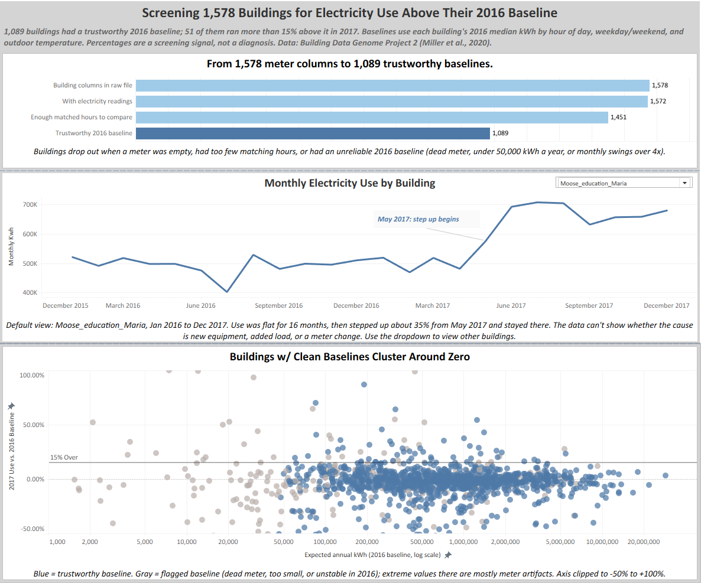
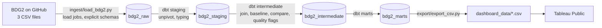

# Building Electricity Baseline Screening

Screening ~1,600 commercial buildings for electricity use that runs above its own historical baseline. An end-to-end pipeline: Python ingestion into BigQuery, dbt models with data quality tests, automated runs in GitHub Actions, and a Tableau Public dashboard.

**Live dashboard:** https://public.tableau.com/app/profile/brian.curran/viz/BuildingElectricalBaselineScreening/BuildingElectricityBaselineScreening



## Pipeline



| Step | What it does | Code |
|---|---|---|
| Ingest | Downloads the three source files and loads them unchanged into BigQuery. Skips tables that already hold the current file. | [`ingest/load_bdg2.py`](ingest/load_bdg2.py) |
| Staging | Reshapes electricity from wide (1,578 building columns) to long (25.2M rows); types the metadata; renames weather columns. | [`transform/models/staging`](transform/models/staging) |
| Intermediate | Joins readings to buildings and site weather, builds the 2016 baseline, compares 2017, and flags baseline-quality problems. | [`transform/models/intermediate`](transform/models/intermediate) |
| Marts | The three tables the dashboard uses, with the same columns as the original exports. | [`transform/models/marts`](transform/models/marts) |
| Export | Writes the marts to CSV for Tableau Public. | [`export/export_csv.py`](export/export_csv.py) |
| Automation | CI on every push (lint, unit tests, dbt parse); full pipeline weekly or on demand. | [`.github/workflows`](.github/workflows) |

`make docs` generates the dbt documentation site, including a lineage graph of every model.

## Run it yourself

Needs Python 3.11+, `make`, and a Google Cloud project with BigQuery (the free sandbox works). Tested on Linux (WSL).

```bash
# one-time setup
gcloud auth application-default login     # lets the code use your Google account
cp .env.example .env                      # then put your project ID in .env
make setup                                # virtualenv, Python packages, dbt packages

# every run
make all                                  # ingest -> dbt build (models + tests) -> export CSVs
```

Other targets: `make test` (unit tests and lint, no BigQuery needed), `make ingest-force` (reload raw tables), `make docs`. Run `make help` for the list.

The method's thresholds are dbt variables in [`dbt_project.yml`](transform/dbt_project.yml), so a sensitivity run is one command:

```bash
cd transform && ../.venv/bin/dbt build --vars '{unstable_month_ratio: 3}'
```

## Scheduled runs

[`pipeline.yml`](.github/workflows/pipeline.yml) runs the whole pipeline every Monday and on demand (Actions tab > Pipeline > Run workflow). It uploads the dashboard CSVs and the dbt docs as a run artifact. To turn it on:

1. In Google Cloud, create a service account with the **BigQuery User** and **BigQuery Data Editor** roles, and create a JSON key for it.
2. In this repo's Settings > Secrets and variables > Actions, add the key as a secret named `GCP_SA_KEY`, and add a variable named `GCP_PROJECT` with the project ID.

Until both exist, the workflow skips itself with a notice instead of failing.

## Data quality tests

`dbt build` runs every test after the model it checks, and stops downstream models if one fails.

| Test | Why |
|---|---|
| Raw electricity has exactly 17,544 distinct hours | Two full years (2016 was a leap year: 8,784 + 8,760); catches a partial or doubled load |
| One row per building per hour; every reading's building exists in the metadata | The reshape must not duplicate or orphan readings |
| One weather row per site per hour | A duplicate would silently multiply meter rows in the join |
| Enrichment keeps every reading | Joining buildings and weather must not drop or add rows |
| kWh is never negative; air temperature within -60 to 60 °C (warning) | Range checks on the inputs |
| Baseline status is one of the four known values | Guards the flag logic |
| Median building lands within ±10% of its baseline | Method sanity check: most buildings barely change year to year (the original run was -2.2%) |
| Funnel counts never increase from one stage to the next | Each stage is a subset of the previous one |

The ingest code has its own unit tests in [`tests/`](tests): Git LFS pointer detection, schema checks for each file, and the logic that decides whether a table is already current.

## Design decisions

- **Rebuildable from source.** The BigQuery sandbox deletes tables after 60 days, so nothing in the warehouse is precious. `make all` recreates every table from the original files, and the dashboard's data is committed to the repo in [`dashboard_data/`](dashboard_data).
- **Full replace, no MERGE.** The sandbox doesn't allow DML (INSERT/UPDATE/MERGE), so loads use batch load jobs that replace the table, and dbt builds full tables. The source is a fixed historical dataset, so incremental loading would add complexity without benefit here.
- **Idempotent ingest.** Each raw table is labeled with the size and row count of the file it came from. A rerun checks those labels against the remote file and skips the download when nothing changed.
- **No date partitioning, on purpose.** In the sandbox, partitions expire 60 days after their partition date, so partitioning 2016-2017 data by date would expire it on arrival. The large tables are clustered by building instead.
- **Explicit schemas instead of auto-detect.** BigQuery's auto-detect only samples the top of a file; the first hand-built version of this project ended up with 25 building columns typed as text. The ingest step now declares every electricity column FLOAT64, and loads the metadata as text so typing happens in dbt where it's visible and tested.
- **Unpivot generated from warehouse metadata.** The 1,578-column unpivot is built from the raw table's own column list (a dbt macro), replacing the original `EXECUTE IMMEDIATE` dynamic SQL.
- **Cost guardrail.** dbt is configured with `maximum_bytes_billed`, so any single query that would scan more than 20 GB fails instead of running.
- **Flag, don't delete.** Buildings that fail a baseline-quality check keep a status instead of disappearing, so every number in the funnel can be traced.

## The analysis

### The question

Given two years of hourly electricity data from many buildings, which ones used noticeably more in 2017 than their own 2016 pattern would predict, after accounting for time of day, weekday vs. weekend, and outdoor temperature? And how do you keep meter problems from showing up as "findings"?

### Results at a glance

| Stage | Buildings |
|---|---|
| Building columns in the raw electricity file | 1,578 |
| With any electricity readings | 1,572 |
| Enough matched hours to compare 2017 to 2016 | 1,451 |
| **Trustworthy 2016 baseline** | **1,089** |

- Among the 1,089 buildings with a trustworthy baseline, the median building used **2.2% less** in 2017 than its baseline predicted. A baseline that centers near zero is what a working method should produce.
- **51** of those buildings ran more than 15% above baseline.
- The other 362 buildings were flagged rather than ranked: 237 had an unstable 2016 (a large change inside the baseline year), 85 were too small to trust, and 40 had a dead or near-zero meter for part of 2016.

### Method

**Baseline.** For each building, the median 2016 kWh for every combination of hour of day, weekday/weekend, and outdoor temperature band (10 °F bands; the source weather is in Celsius and was converted). Medians resist spikes and meter glitches better than averages. Combinations seen fewer than 3 times are dropped.

**Comparison.** Each 2017 hour is matched to the same building's baseline for the same conditions. Actual and expected kWh are summed over the same matched hours, so the comparison is like-for-like. `pct_over = (actual - expected) / expected`. Buildings with fewer than 4,000 matched hours are excluded.

### What went wrong first (and how it was fixed)

The first ranking by percent over put meter artifacts at the top. Monthly profiles showed why: several top buildings had a change inside 2016, the baseline year, so their baseline mixed "before" and "after." Examples: a meter that read zero for 23 months, a building that went from ~20,000 to ~0 to ~70,000 kWh a month during 2016, and two that stepped up by 8x or more.

The fix was a baseline-quality check on each building's 2016 data, which **flags rather than deletes** (every building keeps a status):

| Status | Rule |
|---|---|
| `dead_meter_2016` | more than 5% of 2016 hours read near zero |
| `low_baseline` | under 50,000 kWh in 2016 |
| `unstable_2016` | largest month more than 4x the smallest |
| `ok` | passes all three |

A sensitivity check with a stricter 3x cutoff changed only one building in the top 15, so the ranking isn't sensitive to the exact threshold.

### Example findings

- **Moose_education_Maria:** roughly flat at ~500,000 kWh a month for 16 months, then a sustained step up of about 35% starting May 2017. It has the largest excess among buildings with a clean baseline, about 1.3 million kWh in 2017.
- **Robin_education_Zenia:** stepped up about 40% in Oct 2016 and stayed there. A real shift, but it happened inside the baseline year, so the model's +42.8% overstates a "2017" problem.
- **Eagle_assembly_Josie:** passed the filter (month ratio 3.9x) but was a false positive: its load ramped up through 2016. A monthly profile review caught it.
- **Hog_services_Adrianna:** similar to 2016 most months, with a March spike in both years and a large December 2017 spike. A candidate for an hourly drill-down.

### Limitations

- This is a **screening method**: it flags candidates for investigation and does not diagnose faults. A jump could be new equipment, added load, longer occupancy, a renovation, or a meter change.
- It assumes 2016 is a representative baseline year. The quality filter catches many but not all violations (see Josie above), so featured buildings should get a monthly-profile check.
- No occupancy calendar, holiday, or school-schedule model. Comparing year over year helps, since both years share a calendar, but education buildings (7 of the top 15) may be affected.
- Thresholds (5%, 50,000 kWh, 4x) are judgment calls, not standards.
- Weather is site-level, not building-level. I used the timestamps as provided and did not independently verify time-zone alignment between the meter and weather files.
- Medians use BigQuery's `APPROX_QUANTILES`, so they are approximate, and a rebuild can shift borderline values slightly.
- Electricity only; the dataset's other meter types weren't analyzed.

## Data

[Building Data Genome Project 2](https://github.com/buds-lab/building-data-genome-project-2) (Miller et al., 2020, *Scientific Data*): hourly whole-building meter data for two years (2016-2017), plus building metadata and hourly site-level weather. This project uses the cleaned electricity meters, the building metadata, and the weather file. See the source repository for license and citation details.

The large files in that repo are stored with Git LFS. GitHub's "Download ZIP" and raw-file links return small pointer files instead of the data, so the ingest step downloads from GitHub's LFS media URLs and checks that it didn't get a pointer.

## Repo layout

```
ingest/            Python: download source files, load to BigQuery (raw layer)
transform/         dbt project: models, tests, macros, connection profile
export/            Python: write the dashboard tables to CSV
dashboard_data/    the CSVs the Tableau Public dashboard uses
tests/             Python unit tests
.github/workflows/ CI and the scheduled pipeline
sql/               the original hand-run BigQuery script this pipeline replaced
```

## Tools

BigQuery, dbt, Python, GitHub Actions, Tableau Public. I designed the analysis approach and reviewed every result. I used an AI assistant (Claude) to help write and debug the SQL, the Python, the dbt project, and the GitHub Actions workflows, and to talk through methodology and pipeline design.
